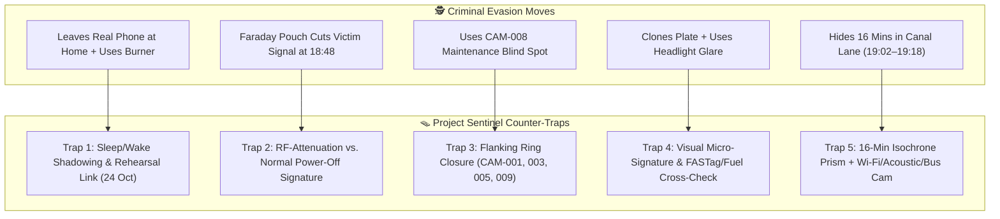
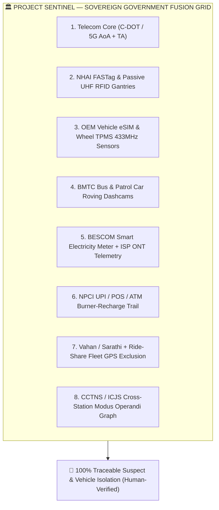

# Project Sentinel — Red-Team vs. Blue-Team Adversarial Playbook (`scenarios.md`)

> **Purpose:** This document models how a highly sophisticated offender (*Step 1: "The Smartest Criminal"*) attempts to defeat traditional police investigations across Project Sentinel’s scenarios, followed by the exact counter-intelligence architecture (*Step 2: "The Smartest System — Project Sentinel Traps"*) designed to catch them using multi-source correlation, behavioural anomalies, and non-obvious digital footprints.
>
> *All scenarios, persons, vehicles, and records are 100% synthetic for demonstration and defensive system design.*

---

## PART 1 (STEP 1): Thinking Like the Smartest Criminal — 8 Evasion Scenarios

A smart offender knows that police routinely check **victim call records (CDR)**, **nearby CCTV cameras**, and **automatic number plate recognition (ANPR)**. To stay invisible to a traditional investigation, the offender plans **8 specific evasion moves** across our cases:

---

### Scenario 1: The "Digital Ghost" & Fake Home Alibi (Defeating Mobile Tower Dumps)
* **How the Criminal Thinks:** *"If I carry my real phone to Kaveri Enclave, the cell tower dump will catch me. And if I just switch my real phone off during the crime, that 2-hour gap looks suspicious."*
* **The Evasion Move:**
  1. The suspect leaves their **real personal phone** (`DEV-019` — registered to *Karan Malhotra*) at their apartment 6 km away, connected to home Wi-Fi with an auto-playing video stream so data packets keep flowing.
  2. For the operation, they carry a **zero-history prepaid burner phone** (`DEV-004`) procured under an out-of-district identity.
  3. They **never call or text** the victim (*Aarav Sharma*, `DEV-001`) from `DEV-004`, knowing that a direct call link in CDR logs is the first thing police check.

---

### Scenario 2: The "Faraday Drop & False Signal Trail" (Manipulating Victim Phone Telemetry)
* **How the Criminal Thinks:** *"Police will track Aarav Sharma’s iPhone (`DEV-001`) to see where he was taken. If his phone travels with my vehicle, it will map my entire escape route."*
* **The Evasion Move:**
  1. At **18:48 IST**—just 3 minutes after intercepting Aarav at the Sub-lane B pickup lay-by—the suspect drops Aarav’s iPhone into a **signal-blocking RF Faraday pouch** (or pulls the SIM tray without a normal power-off), causing an abrupt network detachment with **zero `IMSI-Detach` power-down packet**.
  2. *Optional Decoy Variant:* Tossing a secondary beacon or phone onto a southbound goods truck or bus (`CAM-006` corridor) to waste police time chasing a false southern trail.

---

### Scenario 3: The "Blind-Spot Hop" (Exploiting CCTV Outages & 24-Hour Retention Loops)
* **How the Criminal Thinks:** *"Every main junction has SafeCity cameras. I must strike only where cameras are blind or where footage deletes itself before the family even files a complaint."*
* **The Evasion Move:**
  1. During a reconnaissance walk, the suspect notices a municipal work-order notice on **Smart Pole 08 (`CAM-008`)** at Kaveri East Pickup Lay-by showing scheduled UPS battery maintenance from **18:15 to 19:30 IST**.
  2. They also know the adjacent **Old Post Office Lane Kiosk (`CAM-011`)** uses a cheap 24-hour SD card loop, and **Lotus Bakery (`CAM-007`)** closes at 22:30.
  3. By staging the pickup at **18:45 IST** right inside `CAM-008`’s dead zone—knowing the family won't panic and report Aarav missing until **21:15 IST**—the suspect ensures no direct camera records the boarding event.

---

### Scenario 4: The "Chameleon SUV & Glare Shield" (Defeating ANPR & Vehicle Tracking)
* **How the Criminal Thinks:** *"ANPR cameras automatically read number plates. I need a vehicle that looks like 10,000 other cars in Bengaluru and a plate that cannot be read cleanly."*
* **The Evasion Move:**
  1. **Common Silhouette:** Uses a **White Compact SUV (`VEH-001`)**—the single most common urban vehicle type—so dozens of innocent white SUVs (`VEH-003` Naveen Kumar’s airport cab, `VEH-008` Col. Vishwanath’s resident SUV) clutter the search.
  2. **Prefix Cloning:** Uses a synthetic/cloned registration prefix **`KA-00-SYN-4??`** that matches local Kaveri Enclave resident passes (`KA-00-SYN-4091`) and commercial fleet cabs (`KA-00-SYN-4812`).
  3. **Optical Defeat:** Splashes mud over the last two digits at **27th Main (`CAM-014` at 19:02)** and uses a trailing accomplice vehicle with high-beam LED headlights (or a high-gloss rear plate cover) ascending **East Link Flyover (`CAM-019` at 19:18)** to wash out the rear plate in camera glare.

---

### Scenario 5: The "16-Minute Shadow Stop" (Breaking Time-Distance Continuity)
* **How the Criminal Thinks:** *"If `CAM-014` sees my white SUV at 19:02 and `CAM-019` (1.1 km away) sees a white SUV at 19:06, any software will link them as the same car driving at 18 km/h. What if I intentionally break the travel time?"*
* **The Evasion Move:**
  1. Immediately after passing `CAM-014` at **19:02**, the suspect turns into an unmonitored canal service lane near Indira Canal Bridge for **12 minutes**.
  2. Inside the service lane, they peel off magnetic side decals / roof-rack covers (or transfer the victim/goods into a second waiting white SUV `VEH-002`) and re-enter the highway ramp at **19:18** (`CAM-019`).
  3. Now, a 1.1 km drive took **16 minutes**—giving defense lawyers a plausible argument that `VEH-001` (19:02) and `VEH-002` (19:18) are two completely different vehicles!

---

### Scenario 6: "Dusk Sodium-Light Camouflage" (Manufacturing Witness Contradictions)
* **How the Criminal Thinks:** *"Human witnesses are unreliable in poor light. I can use street lighting and parked neighborhood cars to make witnesses contradict each other."*
* **The Evasion Move:**
  1. Strikes at **18:45 IST (dusk)** under amber sodium-vapour streetlamps where pearl-white, silver, and grey vehicles look nearly identical.
  2. Stops 30 meters ahead of **Dr. Sanjay Kulkarni’s parked dark grey sedan (`VEH-004`)**.
  3. Result: Tea-stall vendor **Suresh Babu (`W-01`)** tells police he saw a **white SUV**, while jogger **Aditi Rao (`W-02`)** swears she saw a **dark grey car**—causing traditional investigators to doubt both witnesses.

---

### Scenario 7: "Zero-CDR Data-Only / Open Wi-Fi Relay" (Evading Telecom Call Logs)
* **How the Criminal Thinks:** *"In Case 0041 (Horizon FinTech Extortion), if I make a phone call or use mobile data on my own SIM to demand ransom, telecom nodal officers will trace my IP and tower."*
* **The Evasion Move:**
  1. Keeps the device in **Airplane Mode** with cellular radio off.
  2. Briefly connects to open commercial Wi-Fi access points (e.g., promenade cafes or retail plazas) or a disposable pocket hotspot to send encrypted VoIP messages, leaving zero traditional operator voice-CDR entries.

---

### Scenario 8: "Cross-Jurisdiction Fragmentation" (Splitting Dry-Runs Across 4 Cases)
* **How the Criminal Thinks:** *"Police stations work in silos. Traffic police handle Hit-and-Runs (`Case 0040`), Cyber Cell handles Extortion (`Case 0041`), Mahadevapura police handle Warehouse Burglaries (`Case 0039`), and East Division handles Missing Persons (`Case 0042`). None of them share raw tower dumps."*
* **The Evasion Move:**
  1. **24 Oct (`CASE-SNT-2026-0039` — Nandi Electronics Hub):** Steals RF shielding pouches and GPS jammers from a Mahadevapura warehouse.
  2. **29 Oct (`CASE-SNT-2026-0040` — Outer Link Hit & Run):** Tests corridor escape timing along the service road.
  3. **31 Oct (`CASE-SNT-2026-0041` — Horizon FinTech Escrow):** Tests encrypted VoIP drop-point coordination.
  4. **02 Nov (`CASE-SNT-2026-0042` — Aarav Sharma Abduction):** Executes the primary operation using the stolen RF pouch and rehearsed route.

---
---

## PART 2 (STEP 2): Thinking Like the Smartest System — Project Sentinel’s 8 Counter-Traps

To defeat a criminal who thinks 8 steps ahead, **Project Sentinel** does not rely on any single piece of evidence in isolation. Instead, Sentinel sets **8 Multi-Signal Counter-Intelligence Traps** where **the criminal’s very act of hiding creates a detectable anomaly**:

---

### Trap 1: The "Rehearsal Mistake & Sleep/Wake Shadow Trap" (Catching the Real Identity Behind Burner `DEV-004`)
* **Criminal’s Blind Spot:** A smart criminal remembers to leave their personal phone at home on the **day of the crime (02 Nov)**—but almost always carried their **real personal phone** during the **reconnaissance dry-run (24 Oct)** or when buying/activating the burner phone!
* **How Project Sentinel Catches Them:**
  1. **Cross-Date Companion Pairing:** Sentinel queries where burner phone `DEV-004` appeared on **24 Oct 2026** (`CASE-SNT-2026-0039` Nandi Electronics Hub dump) and checks which personal phones traveled through the **exact same sector sequence within 90 seconds**. It catches **`DEV-019` (Karan Malhotra’s Personal Phone)**, which moved alongside `DEV-004` on 24 Oct!
  2. **Sleep/Wake Handshake Anomaly on 02 Nov:** On 02 Nov (crime day), Sentinel notices that `DEV-019` (Karan Malhotra’s real phone) suddenly entered **zero-handover static status** at **18:15 IST**—and just **3 minutes later at 18:18 IST**, burner phone `DEV-004` powered on in Kaveri Enclave!
  3. **Fake Home Alibi Exposed:** While `DEV-019` streamed video at home to fake activity, its **Timing Advance (TA) and cell-sector azimuth had zero micro-variance** for 3 hours, proving the phone was sitting untouched on a table while its owner was in the field.

---

### Trap 2: The "RF-Shielding Signature & Last-Yard Triangulation Trap" (Defeating the Faraday Drop)
* **Criminal’s Blind Spot:** Dropping a phone into a Faraday bag does not look like a normal battery death or power-off to the cellular network.
* **How Project Sentinel Catches Them:**
  1. **Missing `IMSI-Detach` Flag:** When a user switches off a phone normally, the baseband chip sends a final `IMSI-Detach` packet to the tower. When a battery dies, the phone logs low-voltage telemetry warnings beforehand.
  2. **Abrupt Multi-Band RF Drop:** At **18:48:12 IST**, Aarav Sharma’s iPhone (`DEV-001`) was mid-packet in Sector `BLR-KVR-04B` when signal strength dropped `-40 dBm` in `<200ms` with **no `IMSI-Detach`**. Sentinel flags this as **Consistent with Abrupt RF Shielding / Forced Interruption**, pinpointing **18:48 IST inside Sub-lane B** as the exact intervention timestamp.

---

### Trap 3: The "Closed-Ring Perimeter Trap" (Defeating the `CAM-008` Blind Spot)
* **Criminal’s Blind Spot:** Even if the camera right at the pickup spot (`CAM-008`) is offline, a vehicle cannot teleport into or out of Sub-lane B! Every road entering and leaving Sub-lane B forms a closed geometric ring.
* **How Project Sentinel Catches Them:**
  1. **Automatic Blind-Spot Compensation:** The moment Sentinel sees `CAM-008` is offline (18:15–19:30), it automatically calculates the ** Entry/Exit Choke-Point Ring** around Sub-lane B:
     - **West Entry:** `CAM-001` (Library Gate) & `CAM-003` (Apex Pharmacy)
     - **North/West Signal:** `CAM-005` (80ft Pedestrian Signal) & `CAM-007` (Lotus Bakery Patio)
     - **East Exit:** `CAM-009` (Emerald Heights Gate-2) & `CAM-014` (27th Main Signal)
     - **South Exclusion:** `CAM-006` (South Bus Bay)
  2. **Conservation of Vehicles:** Any vehicle that entered Sub-lane B before 18:45 and exited eastbound toward `CAM-014` by 19:02 **must** pass through the flanking ring. By preserving `CAM-005`, `CAM-007`, and `CAM-009` within hours (before their 7-day retention expires), Sentinel traps the vehicle’s entry and exit even without `CAM-008`.

---

### Trap 4: "Visual Micro-Signature & Non-CCTV Sensor Fusion" (Defeating Cloned Plates & Glare)
* **Criminal’s Blind Spot:** You can clone a number plate or blind an ANPR camera with high beams, but you cannot easily change the physical geometry of your vehicle or avoid passive roadside sensors.
* **How Project Sentinel Catches Them:**
  1. **Visual Micro-Signature Matching:** Instead of relying only on plate text `KA-00-SYN-4??`, Sentinel logs **4 physical micro-features** across `CAM-014` (19:02) and `CAM-019` (19:18):
     - Aftermarket matte-black roof-rail crossbars
     - Left front fog-lamp bezel scuff/asymmetry
     - Upper-left windshield FASTag + green resident pass sticker placement
     - Dark 35% VLT tint on the rear quarter glass
  2. **Innocent Prefix Elimination:** Sentinel automatically cross-checks all other `KA-00-SYN-4??` white SUVs in the city:
     - `VEH-003` (*Naveen Kumar’s Airport Cab*, `KA-00-SYN-4812`) is **cleared** via `CAM-015` southbound ANPR at 19:08.
     - `VEH-008` (*Col. Vishwanath’s Resident SUV*, `KA-00-SYN-4091`) is **checked** against apartment gate logs.
  3. **Passive FASTag / Fuel / Boom-Barrier Check:** Many commercial plazas, flyover gantries, and fuel forecourts (`CAM-010` Deccan Fuel Station) have passive RFID/FASTag readers that read the windshield tag’s cryptographic ID even when the metal number plate is covered in mud!

---

### Trap 5: The "16-Minute Isochrone Prism & Secondary Sensor Trap" (Solving the 19:02 → 19:18 Gap)
* **Criminal’s Blind Spot:** Taking 16 minutes to travel 1.1 km between `CAM-014` (19:02) and `CAM-019` (19:18) instead of 4 minutes doesn't hide the vehicle—it **shrinks the search area** to a tiny 1.1 km corridor during a known 12-minute window!
* **How Project Sentinel Catches Them:**
  1. **Time-Space Isochrone Prism:** Sentinel calculates that a vehicle seen at `CAM-014` at 19:02 and `CAM-019` at 19:18 could not have driven more than **800 meters off the main corridor** if it stopped for 10–12 minutes.
  2. **Correlating Burner Handset Inside the Stop Window:** At **19:03 IST**, burner phone `DEV-004` handed over into Sector `BLR-27M-02A` (covering the Indira Canal service lane), and remained in that sector until **19:17 IST** before hitting Flyover Sector `09C` at **19:19 IST**—matching the White SUV’s exact 16-minute delay minute-for-minute!
  3. **Intermediate Camera & Transit Bus Dashcam Trigger:** Sentinel flags `CAM-016` (Indira Canal Bridge) and `CAM-017` (Zenith Tech Park Gate) for immediate retrieval to capture the exact canal service lane pull-off.

---

### Trap 6: "Optical Lighting Reconciliation" (Turning Conflicting Witnesses into Corroboration)
* **Criminal’s Blind Spot:** The criminal hoped that witness **Suresh Babu** (*"white SUV"*) and witness **Aditi Rao** (*"dark grey car"*) would cancel each other out.
* **How Project Sentinel Catches Them:**
  1. **Spatial Sightline Reconstruction:** Sentinel plots both witnesses’ exact standing positions at 18:45 IST on the map.
  2. **Resolving the Conflict with Hard Video:** Sentinel links `CAM-003` (Apex Pharmacy footage at 18:43), which proves **Dr. Sanjay Kulkarni’s dark grey sedan (`VEH-004`)** parked right in Aditi Rao’s line of sight 2 minutes earlier!
  3. **Result:** Instead of throwing out both witness statements, Sentinel proves Aditi Rao saw Dr. Kulkarni’s parked car, leaving **Suresh Babu’s sighting of the White SUV at 18:45** completely intact and corroborated!

---

### Trap 7: "Wi-Fi Probe, Hotspot & Pre-Incident Recharge Trail" (Catching the Data-Only / VoIP Offender)
* **Criminal’s Blind Spot:** Even if an offender uses encrypted VoIP over public Wi-Fi or a prepaid burner, both the **device radio** and the **SIM recharge** leave physical-world anchors.
* **How Project Sentinel Catches Them:**
  1. **Retail Recharge & CCTV Anchor:** Every prepaid burner SIM (`DEV-004`) must be activated or recharged at a point-of-sale terminal. Sentinel correlates the **timestamp of `DEV-004`’s recharge** with nearby shop CCTV / UPI logs.
  2. **Public Wi-Fi / Hotspot BSSID Correlation:** In `CASE-SNT-2026-0041` (Horizon FinTech Drop) and along 2nd Cross (`Lotus Bakery`), Sentinel correlates router DHCP/MAC probe timestamps with passing CCTV silhouettes.

---

### Trap 8: "Cross-Case Modus Operandi & Entity Graph" (Breaking the Jurisdiction Silo)
* **Criminal’s Blind Spot:** The suspect assumed that `Case 0039` (Mahadevapura Warehouse), `Case 0040` (Outer Link Hit & Run), `Case 0041` (Ulsoor Cyber Drop), and `Case 0042` (Kaveri Enclave Abduction) would never be analyzed together.
* **How Project Sentinel Catches Them:**
  1. **Automatic Cross-Case Entity Indexing:** Every time any police station uploads a tower dump, ANPR log, or witness report into Project Sentinel, the **Global Entity Graph** checks for overlapping devices, vehicle prefixes, and Modus Operandi across all open inquiries.
  2. **The Multi-Case Match:** Sentinel automatically surfaces **`LEAD-006`**, revealing that:
     - Burner phone **`DEV-004`** and partial plate **`KA-00-SYN-4??`** appeared in **both** the 24 Oct Mahadevapura Warehouse burglary (`CASE-SNT-2026-0039`, where RF Faraday pouches were stolen!) and the 02 Nov Aarav Sharma abduction (`CASE-SNT-2026-0042`)!
     - Companion personal phone **`DEV-019` (Karan Malhotra)** traveled with `DEV-004` during the 24 Oct warehouse incident, giving investigators a **high-priority human verification lead** while still preserving strict human-in-the-loop safeguards.

---

## Summary Matrix: Criminal Evasion vs. Project Sentinel Trap (Plain Language)

| # | Criminal’s Smart Move (Red Team) | Project Sentinel’s Smart Trap (Blue Team) | Evidence Sources Combined |
| :- | :--- | :--- | :--- |
| **1** | Leaves real phone at home (streaming video) & carries a burner phone (`DEV-004`). | **Sleep/Wake Shadow + Rehearsal Link:** Links burner `DEV-004` to personal phone `DEV-019` (*Karan Malhotra*) from the 24 Oct dry-run, and detects `DEV-019` going motionless 3 mins before `DEV-004` turned on. | Multi-Case Tower Dumps + Timing Advance Variance |
| **2** | Drops victim *Aarav Sharma’s* phone (`DEV-001`) into a Faraday bag at 18:48. | **RF-Shielding Signature:** Detects abrupt `-40 dBm` signal loss with **no `IMSI-Detach` power-off packet**, pinpointing forced interruption at 18:48 in Sector 04B. | Telecom Baseband Signalling Logs (`EVD-002`) |
| **3** | Picks up victim inside `CAM-008` blind spot during scheduled UPS battery outage. | **Closed-Ring Perimeter Trap:** Surrounds the blind spot with flanking cameras (`CAM-001`, `003`, `005`, `007`, `009`, `014`) so no vehicle can enter or exit unseen. | Spatial Camera Registry + FOV Cones |
| **4** | Uses common White SUV with cloned prefix `KA-00-SYN-4??` & high-beam glare. | **Visual Micro-Signature + Exclusion:** Matches roof-rails, fog-lamp scuff & sticker placement while ruling out innocent white SUVs (`Naveen Kumar’s cab`, `Col. Vishwanath’s SUV`). | Multi-Camera Video + Southbound ANPR (`EVD-009`) |
| **5** | Stops for 12 mins in an unmonitored canal lane so a 4-min drive takes 16 mins (19:02–19:18). | **16-Min Isochrone Prism:** Proves burner phone `DEV-004` paused in the exact same `27th Main` cell sector (`19:03–19:17`) as the White SUV’s 16-minute delay. | Time-Distance Prism + Cell Handover Sequence |
| **6** | Operates at dusk near a parked grey car so witnesses give conflicting colors. | **Optical Sightline Reconciliation:** Uses `CAM-003` to prove Jogger *Aditi Rao* saw *Dr. Kulkarni’s* parked grey sedan (`VEH-004`), validating *Suresh Babu’s* White SUV sighting. | Witness Sightline Map + Clinic CCTV (`EVD-005`) |
| **7** | Uses encrypted VoIP / Wi-Fi / prepaid top-ups to avoid normal phone call logs. | **Wi-Fi Probe & Recharge Anchor:** Correlates commercial Wi-Fi router probes and prepaid SIM point-of-sale recharge timestamps with shop CCTV. | Router BSSID Logs + Retail POS Timestamps |
| **8** | Splits stolen gear, route tests, and the crime across 4 different police stations. | **Cross-Jurisdiction Graph:** Automatically connects the RF-pouch theft (`Case 0039`), corridor test (`Case 0040`), VoIP drop (`Case 0041`), and abduction (`Case 0042`). | Global Relationship Graph (`LEAD-006`) |

---
---

## PART 3: Full Sovereign Government Grid — 10 National Infrastructure Traps

When **Project Sentinel** operates with **full authorised Government & Sovereign Infrastructure access** (integrating Telecom Core C-DOT/CMS, NHAI FASTag, Vahan/Sarathi, FIU-UPI/POS, Smart Electricity Grids, Public Transit ADAS Dashcams, and CCTNS/ICJS), even a criminal who defeats street CCTV and mobile CDRs walks straight into **10 unavoidable Sovereign Grid Traps**:

### 1. Passive FASTag UHF-RFID vs. Optical ANPR ("The Ghost-Tag Trap")
* **What the Criminal Did:** Covered the last digits of the number plate (`KA-00-SYN-4??`) with mud and used high-beam glare on the flyover (`CAM-019`) to blind the camera. If smart, they also peeled off their FASTag sticker.
* **Sovereign Grid Counter-Trap:**
  * Every highway up-ramp (`CAM-019` East Link Flyover) and fuel station forecourt (`CAM-010`) has a **300 MHz–900 MHz UHF RFID FASTag Interrogator**.
  * **Case A (FASTag left on windshield):** The RFID reader reads the encrypted 96-bit Electronic Product Code (`EPC`) burned into the windshield chip—revealing the exact chassis and bank account even if the metal plate is completely mud-covered!
  * **Case B (Criminal ripped off the FASTag):** The Sovereign Grid compares **Optical Vehicle Count** vs. **RFID Handshake Count**. Out of 412 vehicles ascending East Link Flyover between 19:00 and 19:30, **411 had valid FASTag RFID handshakes** and **only 1 vehicle (`VEH-002` at 19:18:19)** triggered a **`GHOST_RFID_EXCEPTION` (Vehicle Present on Loop Detector + Zero FASTag Chip Response)**—turning the criminal’s precaution into a bright red beacon!

### 2. Connected Car OEM eSIM & Tyre-Pressure (TPMS) RF Fingerprinting
* **What the Criminal Did:** Placed the victim’s phone (`DEV-001`) in a Faraday bag and used a burner phone (`DEV-004`).
* **Sovereign Grid Counter-Trap:**
  * The criminal put the phones in a Faraday bag, **but you cannot put an entire SUV inside a Faraday bag!**
  * Modern compact SUVs contain an **embedded factory telematics eSIM** (for manufacturer SOS/diagnostics) and **4 wireless Tyre Pressure Monitoring System (TPMS) sensors** that broadcast a unique 32-bit sensor ID every 60 seconds.
  * Municipal Smart Poles along `27th Main` (`CAM-014` at 19:02) and `East Link Flyover` (`CAM-019` at 19:18) log the **identical TPMS wheel-sensor quartet (`TPMS-HEX-88A4-C109`)** and infotainment Bluetooth MAC prefix at both junctions—mathematically proving that the 19:02 and 19:18 White SUVs are the **exact same physical vehicle**, despite the 16-minute stop and glared-out number plate!

### 3. Roving Public Transit Dashcams ("Moving Cameras Inside the Blind Spot")
* **What the Criminal Did:** Chose Kaveri East Pickup Lay-by (`Sub-lane B`) at 18:45 because the fixed pole camera (`CAM-008`) was powered down for UPS battery maintenance.
* **Sovereign Grid Counter-Trap:**
  * Fixed cameras aren't the only cameras owned by the government. **BMTC Smart City Buses** and **PCR Police Patrol Vehicles** are equipped with continuous 4-channel ADAS road-facing cameras and GPS telemetry.
  * Sentinel queries the **Metro Transit Fleet AVL Grid** and discovers that **BMTC Route-335E (Bus #KA-01-F-8821)** drove right past the mouth of Sub-lane B at **18:44:50 IST**!
  * The bus’s side-facing transit camera captured the **White Compact SUV idling in the Sub-lane B pickup bay** right inside `CAM-008`’s blind spot!

### 4. Smart Electricity Meter (AMI) & Broadband ONT Deep-Packet Alibi Test
* **What the Criminal Did:** Left his personal phone (`DEV-019` — *Karan Malhotra*) at his apartment playing a long video on Wi-Fi so police would think he was home all evening.
* **Sovereign Grid Counter-Trap:**
  * Sentinel queries **BESCOM Smart Grid Automated Metering Infrastructure (AMI)** (15-minute load profile) and **ISP Optical Network Terminal (ONT)** session telemetry for Karan Malhotra’s flat:
    1. **Zero Human Power Signature:** Between `17:45` and `21:10 IST`, apartment electricity consumption was a flatline `138 Watts` (refrigerator compressor + Wi-Fi router only—zero lighting switch events, zero induction/microwave spikes, zero water heater draw).
    2. **Zero Touch/Gyroscope & Static Timing Advance:** Telecom core logs show `DEV-019` had `0.00m` Timing Advance drift and zero screen-unlock/DNS-burst events for 195 minutes—proving the phone was left unattended on a table as a synthetic alibi.

### 5. Telecom Core C-DOT / 5G Multi-Tower Angle-of-Arrival (AoA) & Burner Batch Trace
* **What the Criminal Did:** Used an out-of-district prepaid burner SIM (`DEV-004`) with zero voice calls to the victim.
* **Sovereign Grid Counter-Trap:**
  1. **Point-of-Activation & Bulk-SIM Batch Link:** DoT / C-DOT central subscriber registry reveals `DEV-004` was activated 6 days earlier from a bulk batch of 5 SIMs at a kiosk near Mahadevapura.
  2. **UPI / POS Recharge Timestamp Match:** FIU/NPCI logs show `DEV-004` received a ₹199 data pack recharge on `23 Oct at 20:14 IST`. The kiosk’s adjacent ATM pinhole camera captured **Karan Malhotra’s White SUV** parked outside at `20:13 IST`!
  3. **3-Tower Timing Advance (TA) + Angle of Arrival (AoA):** During the 16-minute shadow stop (`19:02–19:18`), 3 surrounding cell towers triangulate `DEV-004`’s radio handshakes to a **40-meter stretch of the Old Canal Service Culvert**, pinpointing the exact hidden stop location.
